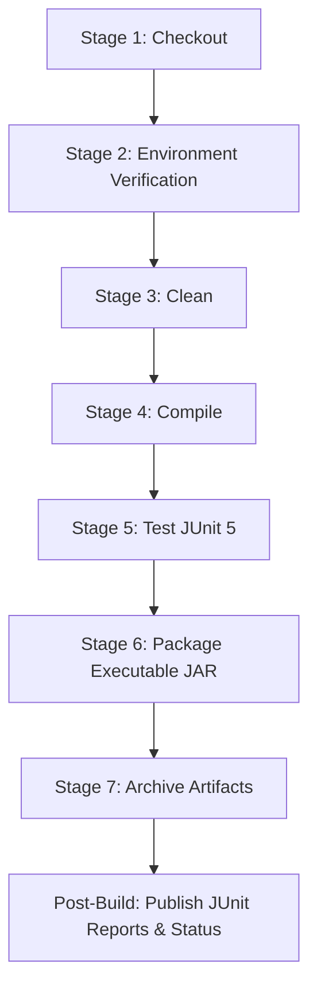

# Inventory Management System with Automated CI/CD (Jenkins & Maven)

[](https://www.oracle.com/java/)
[](https://maven.apache.org/)
[](https://junit.org/junit5/)
[](https://www.jenkins.io/)
[]()

A robust, modular **Java console-based Inventory Management System** built with **Maven**, comprehensively tested with **JUnit 5**, and automated using a **declarative Jenkins CI/CD pipeline**. This project demonstrates enterprise DevOps practices: continuous integration, automated test execution, quality gate enforcement, and executable JAR artifact packaging and archiving.

---

## Table of Contents

1. [Project Overview & Objectives](#1-project-overview--objectives)
2. [Application Features](#2-application-features)
3. [Technology Stack](#3-technology-stack)
4. [Project Directory Structure](#4-project-directory-structure)
5. [Prerequisites & System Setup](#5-prerequisites--system-setup)
6. [Local Build, Test & Run (CLI)](#6-local-build-test--run-cli)
7. [Unit Testing Suite (JUnit 5)](#7-unit-testing-suite-junit-5)
8. [Sample Application Walkthrough](#8-sample-application-walkthrough)
9. [Git & GitHub Integration](#9-git--github-integration)
10. [Jenkins CI/CD Pipeline Automation](#10-jenkins-cicd-pipeline-automation)
11. [Artifact Verification & Execution](#11-artifact-verification--execution)
12. [Troubleshooting & Common Errors](#12-troubleshooting--common-errors)

---

## 1. Project Overview & Objectives

In modern software engineering, manual compiling, testing, and packaging lead to human error, missed regressions, and delayed releases. The primary objective of this project is to implement **Continuous Integration (CI)**:

- **Automated Verification:** Every Git commit triggers a multi-stage Jenkins build.
- **Fail-Fast Testing:** Automated JUnit 5 unit tests execute on every change; if any test fails, artifact generation is halted immediately.
- **Repeatable Artifacts:** Produces a standardized, self-contained executable JAR (`inventory-management-system-1.0.0.jar`) with manifest entries indicating build origin and entry point.
- **Continuous Archiving:** Successful builds archive artifacts directly in Jenkins for one-click download and deployment.

---

## 2. Application Features

The Inventory Management System provides core inventory lifecycle management with strict input validation:

1. **Add Product:** Register products with a unique ID, descriptive name, unit price, stock quantity, and minimum alert threshold.
2. **View Inventory:** Render all products in a structured, ASCII-formatted table showing price, quantity, threshold, and status.
3. **Search Products:** Search products via exact product ID or partial/case-insensitive name substring matching.
4. **Update Stock:** Increment stock (goods received) or decrement stock (units sold/dispatched) with negative-stock prevention.
5. **Delete Product:** Remove items with user confirmation prompts to avoid accidental loss.
6. **Low-Stock Alerts:** Filter and highlight products whose quantities are less than or equal to their configured low-stock threshold.
7. **Inventory Valuation & Statistics:** Calculate total product catalog size and cumulative monetary valuation in real-time.
8. **Input Validation & Error Handling:**
   - Case-insensitive duplicate product ID prevention.
   - Non-negative price validation ($0.00 or greater).
   - Non-negative quantity and threshold enforcement.
   - Guard against stock deductions that exceed current inventory levels.
   - Safe parsing of non-numeric console inputs without program termination.

---

## 3. Technology Stack

| Layer | Technology | Version | Purpose |
| :--- | :--- | :--- | :--- |
| **Language** | Java (JDK) | 21 LTS (or 25) | Core object-oriented programming logic |
| **Build Automation** | Apache Maven | 3.9+ | Dependency management, build lifecycle, packaging |
| **Testing** | JUnit Jupiter (JUnit 5) | 5.10.2 | Unit testing and assertion framework |
| **Test Runner** | Maven Surefire Plugin | 3.2.5 | Executes unit tests & emits XML test reports |
| **Packaging** | Maven JAR Plugin | 3.4.1 | Assembles executable JAR with `Main-Class` manifest |
| **Version Control** | Git & GitHub | 2.40+ | Source code tracking and remote collaboration |
| **CI/CD Automation** | Jenkins | 2.440+ | Declarative multi-stage pipeline orchestration |

---

## 4. Project Directory Structure

```text
inventory-management-system/
├── pom.xml                                   # Maven project object model & plugin config
├── Jenkinsfile                               # Declarative 7-stage CI pipeline definition
├── .gitignore                                # Excludes build targets, IDE, and temporary files
├── README.md                                 # Comprehensive documentation and manual
└── src/
    ├── main/
    │   └── java/
    │       └── com/
    │           └── inventory/
    │               ├── Main.java             # Console UI, menu loops, input formatting
    │               ├── Product.java          # Domain entity with validation rules
    │               └── InventoryService.java # Business logic, CRUD operations, low-stock checks
    └── test/
        └── java/
            └── com/
                └── inventory/
                    └── InventoryServiceTest.java # 25+ automated JUnit 5 tests
```

---

## 5. Prerequisites & System Setup

### 5.1 Required Software

1. **Java Development Kit (JDK 21 or higher):**
   ```bash
   java -version
   javac -version
   ```
2. **Apache Maven (3.9.0 or higher):**
   ```bash
   mvn -version
   ```
3. **Git:**
   ```bash
   git --version
   ```
4. **Jenkins (Local or Server):**
   - Running locally at `http://localhost:8080` (or accessible via network).

### 5.2 Environment Variables (Windows 11 Setup)

Ensure your environment variables are configured in **System Properties > Environment Variables**:

- `JAVA_HOME`: Points to JDK directory (e.g., `C:\Program Files\Java\jdk-21` or `jdk-25.0.2`).
- `MAVEN_HOME`: Points to Maven installation (e.g., `C:\apache-maven-3.9.x`).
- `Path`: Includes `%JAVA_HOME%\bin` and `%MAVEN_HOME%\bin`.

---

## 6. Local Build, Test & Run (CLI)

Navigate into the project root directory:

```bash
cd "inventory-management-system"
```

### 6.1 Clean Build & Compile

Clean previous target output and compile source code:

```bash
mvn clean compile
```

### 6.2 Execute Automated Tests

Run the JUnit 5 test suite through Maven Surefire:

```bash
mvn test
```

*Output summary:*
```text
[INFO] -------------------------------------------------------
[INFO]  T E S T S
[INFO] -------------------------------------------------------
[INFO] Running com.inventory.InventoryServiceTest
...
[INFO] Results:
[INFO] Tests run: 25, Failures: 0, Errors: 0, Skipped: 0
[INFO] BUILD SUCCESS
```

Test reports are written to `target/surefire-reports/`.

### 6.3 Package Executable JAR

Package the application into an executable JAR:

```bash
mvn package
```

The compiled JAR is generated at:
`target/inventory-management-system-1.0.0.jar`

### 6.4 Launch the Application

Run the packaged JAR directly using the Java runtime:

```bash
java -jar target/inventory-management-system-1.0.0.jar
```

---

## 7. Unit Testing Suite (JUnit 5)

The automated test suite in `InventoryServiceTest.java` is isolated from the console UI and verifies:

| Test Group | Test Cases | Objective |
| :--- | :--- | :--- |
| **Add Product** | `testAddProductSuccess`, `testAddProductDuplicateIdThrowsException`, `testAddProductNullThrowsException` | Ensures product additions work and duplicate IDs (case-insensitive) are rejected. |
| **Input Validation** | `testInvalidIdThrowsException`, `testInvalidNameThrowsException`, `testNegativePriceThrowsException`, `testNegativeQuantityThrowsException`, `testNegativeThresholdThrowsException` | Guarantees entity integrity and prevents negative price/stock numbers. |
| **Search & Retrieval**| `testGetAllProducts`, `testGetProductByIdFound`, `testGetProductByIdNotFound`, `testSearchByNameCaseInsensitive`, `testSearchNonExistentReturnsEmpty`, `testUnifiedSearch` | Validates ID retrieval and substring name search behavior. |
| **Stock Updates** | `testUpdateStockIncrease`, `testUpdateStockDecrease`, `testUpdateStockReduceToZero`, `testUpdateStockNegativeResultThrowsException`, `testUpdateStockNonExistentProductThrowsException` | Confirms inventory adjustments and blocks reductions that cause negative balances. |
| **Low-Stock Alerts** | `testLowStockAlerts` | Tests boundary conditions: quantity = threshold, quantity < threshold, quantity > threshold. |
| **Product Deletion** | `testDeleteProductSuccess`, `testDeleteProductNonExistent`, `testDeleteProductNullOrEmpty` | Verifies deletion and graceful handling of missing IDs. |
| **Valuation** | `testCalculateTotalInventoryValue` | Verifies monetary math: sum of (`price * quantity`). |

---

## 8. Sample Application Walkthrough

### 8.1 Main Menu Banner

```text
==========================================================================
                   INVENTORY MANAGEMENT SYSTEM (IMS v1.0)                 
          Automated CI Pipeline with Git, Maven, JUnit 5 & Jenkins        
==========================================================================
Note: 4 initial sample products pre-loaded for immediate demonstration.

--------------------------- MAIN MENU ------------------------------------
  [1] Add Product
  [2] View All Products
  [3] Search Product (by ID or Name)
  [4] Update Stock Quantity (Increase / Decrease)
  [5] Delete Product (with Confirmation)
  [6] View Low-Stock Alerts
  [7] View Inventory Summary & Statistics
  [8] Exit Application
--------------------------------------------------------------------------
Enter your choice (1-8):
```

### 8.2 Viewing All Products (Option 2)

```text
>>> CURRENT PRODUCT INVENTORY
+--------+--------------------------------+------------+----------+-----------+--------------+
| ID     | Name                           | Price ($)  | Quantity | Threshold | Stock Status |
+--------+--------------------------------+------------+----------+-----------+--------------+
| P101   | Dell XPS 15 Laptop             |    1499.99 |       12 |         5 | OK           |
| P102   | Logitech MX Master 3S Mouse    |      99.50 |        4 |        10 | LOW STOCK (!) |
| P103   | Mechanical RGB Keyboard        |      79.99 |       25 |         8 | OK           |
| P104   | USB-C Multiport Hub            |      34.50 |        6 |        15 | LOW STOCK (!) |
+--------+--------------------------------+------------+----------+-----------+--------------+
```

### 8.3 Low-Stock Alerts (Option 6)

```text
>>> LOW-STOCK ALERTS
ALERT: 2 product(s) have reached or fallen below their low-stock threshold!
+--------+--------------------------------+------------+----------+-----------+--------------+
| ID     | Name                           | Price ($)  | Quantity | Threshold | Stock Status |
+--------+--------------------------------+------------+----------+-----------+--------------+
| P102   | Logitech MX Master 3S Mouse    |      99.50 |        4 |        10 | LOW STOCK (!) |
| P104   | USB-C Multiport Hub            |      34.50 |        6 |        15 | LOW STOCK (!) |
+--------+--------------------------------+------------+----------+-----------+--------------+
```

### 8.4 Inventory Valuation & Summary (Option 7)

```text
>>> INVENTORY SUMMARY & STATISTICS
+---------------------------------------------------------------+
| Metric                              |                   Value |
+---------------------------------------------------------------+
| Total Product Types Registered      |                       4 |
| Total Valuation ($ USD)             |                20604.27 |
| Products in Low-Stock State         |                       2 |
+---------------------------------------------------------------+
```

---

## 9. Git & GitHub Integration

Follow these steps to connect your local project to a remote GitHub repository:

### Step 1: Initialize Git Repository

Open PowerShell or Terminal inside the `inventory-management-system/` directory:

```bash
# Navigate to the project root
cd inventory-management-system

# Initialize git repository
git init

# Set default branch to main
git branch -M main
```

### Step 2: Configure Git Identity (if not already set globally)

```bash
git config user.name "Your Name"
git config user.email "your.email@example.com"
```

### Step 3: Stage and Commit Files

```bash
# Verify .gitignore is in place
git status

# Stage all files
git add .

# Create initial commit
git commit -m "feat: initial commit for inventory management system with Maven, JUnit 5, and Jenkinsfile"
```

### Step 4: Link to GitHub Remote Repository

1. Go to [GitHub](https://github.com/) and click **New Repository**.
2. Name it `inventory-management-system`.
3. Leave it public or private, do **not** initialize with README or .gitignore (we already created them).
4. Run the following commands locally:

```bash
git remote add origin https://github.com/<your-username>/inventory-management-system.git
git push -u origin main
```

### Step 5: Committing Future Changes to Trigger CI

Every time you implement a feature or fix a bug:

```bash
git add .
git commit -m "refactor: optimize stock threshold calculations"
git push origin main
```

---

## 10. Jenkins CI/CD Pipeline Automation

### 10.1 Pipeline Stages Overview

The declarative pipeline in [`Jenkinsfile`](file:///e:/1_Chandigarh%20University/3rd%20Sem%20Work/3rd-Sem-PROJECTS/DevOps-Project/inventory-management-system/Jenkinsfile) executes the following 7 stages in sequential order:



1. **Checkout:** Clones the latest source code from the configured Git repository.
2. **Environment Verification:** Inspects and prints `java -version`, `mvn -version`, and `git --version` on the build agent.
3. **Clean:** Executes `mvn clean` to purge stale `.class` files and previous test results.
4. **Compile:** Runs `mvn compile` to build production classes from `src/main/java`.
5. **Test:** Runs `mvn test` to execute all 25 JUnit 5 unit tests.
   - *Quality Gate:* If any test fails, the build terminates here.
   - *Report Publishing:* Parses Surefire XML reports via the Jenkins `junit` plugin.
6. **Package:** Runs `mvn package -DskipTests` to bundle the executable JAR. Redundant test runs are skipped since tests already passed in Stage 5.
7. **Archive Artifacts:** Archives `target/*.jar` into Jenkins storage with fingerprinting.
8. **Post-Build Actions:** Evaluates overall status (`success`, `failure`, `unstable`) and prints status summaries.

### 10.2 Jenkins Setup Instructions

#### Step 1: Verify Required Jenkins Plugins
In Jenkins, navigate to **Manage Jenkins > Plugins > Installed Plugins** and ensure:
- **Pipeline**
- **Git Plugin**
- **JUnit Plugin**
- **Timestamper**

#### Step 2: Configure Global Tools (JDK & Maven)
Navigate to **Manage Jenkins > Tools**:
- **JDK installations:** Add your JDK 21 installation (Name: `JDK-21`, Path: e.g., `C:\Program Files\Java\jdk-21`).
- **Maven installations:** Add your Maven installation (Name: `Maven-3.9.x`, Path: your Maven home directory).

*(Note: If your Jenkins agent has Java and Maven already available on system `PATH`, the cross-platform `bat`/`sh` commands execute directly without additional configuration).*

#### Step 3: Create a Jenkins Pipeline Job
1. From Jenkins Dashboard, click **New Item**.
2. Enter item name: `inventory-management-ci`.
3. Select **Pipeline** and click **OK**.
4. In the Job configuration:
   - Scroll down to the **Pipeline** section.
   - Set **Definition** to: `Pipeline script from SCM`.
   - Set **SCM** to: `Git`.
   - Set **Repository URL** to: your GitHub URL (e.g., `https://github.com/<your-username>/inventory-management-system.git`) or local path.
   - Add credentials if using a private GitHub repository.
   - Set **Branch Specifier** to: `*/main`.
   - Set **Script Path** to: `Jenkinsfile`.
5. Click **Save**.

#### Step 4: Trigger Build & View Pipeline Execution
1. Click **Build Now** on the left menu.
2. Observe the real-time **Stage View**:
   - `Checkout` (Green)
   - `Environment Verification` (Green)
   - `Clean` (Green)
   - `Compile` (Green)
   - `Test` (Green)
   - `Package` (Green)
   - `Archive Artifacts` (Green)
3. Click on the build number (e.g., `#1`) > **Console Output** to view logs.
4. Click on **Test Result** to view the JUnit pass/fail trends and execution breakdown.

#### Step 5: (Optional) Automated Triggers via Webhooks
To automatically build when code is pushed to GitHub:
- In the Jenkins job configuration, check **GitHub hook trigger for GITScm polling**.
- In GitHub: **Repository Settings > Webhooks > Add Webhook**:
  - Payload URL: `http://<your-jenkins-ip>:8080/github-webhook/`
  - Content type: `application/json`
  - Event: `Just the push event`.

---

## 11. Artifact Verification & Execution

### 11.1 Locate Artifact in Jenkins
1. Open the successful build page in Jenkins (e.g., `http://localhost:8080/job/inventory-management-ci/1/`).
2. Under the **Build Artifacts** section at the top of the page, locate:
   - `inventory-management-system-1.0.0.jar`
3. Click on the file link to download the generated JAR.

### 11.2 Locate Artifact Locally
After running `mvn package` or after the pipeline runs, the artifact resides at:
```text
inventory-management-system/target/inventory-management-system-1.0.0.jar
```

### 11.3 Run the Packaged Artifact

Test the packaged artifact on any machine with Java installed:

```bash
java -jar target/inventory-management-system-1.0.0.jar
```

---

## 12. Troubleshooting & Common Errors

### Error 1: `'mvn' is not recognized as an internal or external command`
- **Cause:** Maven `bin` directory is not in your system `Path`.
- **Solution:** Add `C:\apache-maven-3.9.x\bin` (or your Maven path) to the `Path` environment variable. Open a new terminal and verify with `mvn -version`.

### Error 2: `java: release version 21 not supported`
- **Cause:** Maven is using an older JDK (e.g., Java 8, 11, or 17) that does not support Java 21 features.
- **Solution:** Ensure `JAVA_HOME` points to JDK 21+. Run:
  ```bash
  echo %JAVA_HOME%
  javac -version
  ```

### Error 3: Jenkins Build Fails with `sh: command not found` on Windows
- **Cause:** The pipeline invoked `sh` on a Windows agent where POSIX shell is not available.
- **Solution:** The [`Jenkinsfile`](file:///e:/1_Chandigarh%20University/3rd%20Sem%20Work/3rd-Sem-PROJECTS/DevOps-Project/inventory-management-system/Jenkinsfile) provided in this project uses conditional OS detection:
  ```groovy
  if (isUnix()) {
      sh 'mvn test'
  } else {
      bat 'mvn test'
  }
  ```
  This ensures compatibility on both Windows (`bat`) and Linux/macOS/Docker (`sh`) build nodes.

### Error 4: Git Push Authentication Failure
- **Cause:** GitHub requires Personal Access Tokens (PAT) or SSH keys instead of account passwords.
- **Solution:** Go to **GitHub > Settings > Developer Settings > Personal Access Tokens (Tokens classic)**, generate a token with `repo` scope, and use the token as your password when prompted during `git push`.

---

## Authors & Acknowledgments

- **Developer:** DevOps Engineering Student / Candidate
- **Institution:** Chandigarh University
- **Focus Areas:** Java SE Development, Automated Testing (JUnit 5), Build Automation (Maven), Continuous Integration (Jenkins), Version Control (Git).
